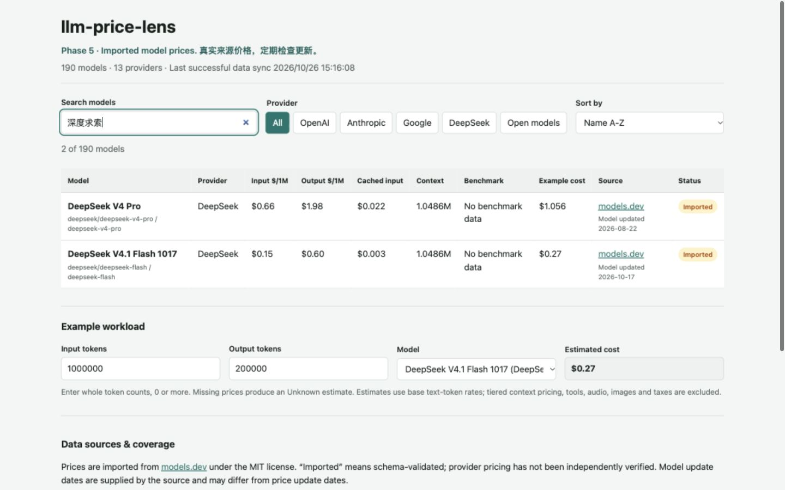

# 项目完成度与调试记录

检查日期：2026-10-26（Asia/Shanghai）。基线：`main` / `d05b1b03f01d2681c4013159937d0a3a7b36cb16`，开始检查时工作区干净。

结论：`PROJECT_SCOPE.md` 中的 18 项 MVP 功能均有实现，Phase 5 已上线。此次检查发现并修复 1 处部署验证缺陷，修复后的 106 项测试、类型检查、构建和产物验证通过。审计结束时修复尚在本地，线上为原有 v0.5.0；用户随后明确要求上线，补丁发布说明见 [RELEASE_0_5_1.md](RELEASE_0_5_1.md)。下文保留审计时点的检查与证据。完成度以既定功能范围为准，价格与评测覆盖限制见下文。

| 需求 | 核对结果 |
| --- | --- |
| 1–8 模型、厂商、ID、输入/输出/缓存价格、上下文、来源、状态、时间 | 190 条记录、13 家提供商；生产使用生成数据，未加载示例数据；缺失价格保持 Unknown，零价格保持零 |
| 9 Benchmark 分数、排名、来源与日期 | 六模型历史 AIME 快照、来源与日期可见；当前端点精确匹配为 0，保持 No benchmark data |
| 10–13 输入价、输出价、成本、Benchmark 升降排序 | 十种页面排序（含名称升降）通过；未知值末尾，相关边界单元测试通过 |
| 14 中英文、别名、近似拼写与描述搜索 | 深度求索、谷歌、克劳德、便宜、写代码、推理模型、长上下文、开源、sonet、GPT 5.4、空查询及无结果状态通过 |
| 15 token 成本计算器 | 默认工作量、零价、缺价、空输入、负数、小数、科学计数法与安全整数边界通过；DeepSeek Flash 默认估算 $0.27 |
| 16 响应式、深色与键盘 | 320、390、760、820、1024、1440 CSS px 无整页横向溢出；表格/卡片、长金额、深色模式、可见焦点和跳转入口通过 |
| 17 GitHub Pages | 线上完整源 SHA、数据和报告哈希与基线一致；本地 Pages 子路径的页面、数据及许可证共 13 个资源通过 HTTP 检查 |
| 18 约 30 分钟上游检查 | sync 工作流处于 active，配置第 7/37 分钟和手动触发；既有手动运行成功，本轮临时副本中两次真实 304 检查均保持快照不变 |

本次修复为部署内容校验缺陷：旧脚本只要求 JS/CSS 请求成功且内容非空。离线重现中，返回 HTTP 200 的 HTML 错误页替代两个 JS/CSS 资源，脚本仍报告 Deployment confirmed。CDN 混合返回不同发布的 HTML、清单和资源时，旧检查也不能充分识别。

修复后，构建在最终 HTML 生成后记录 `pageSha256` 与全部构建 JS/CSS 的 `assetSha256`。构建检查与线上验证逐一比较内容哈希；发布身份、价格、质量报告与历史评测的既有校验继续保留。部署验证函数可以注入请求用于回归测试，CLI 保留原有重试和入口参数检查。

新增 8 项回归测试覆盖：完整匹配的子路径发布（含延迟加载资源）、旧 HTML、以 HTTP 200 错误页替代 JS/CSS/延迟加载资源、清单遗漏资源、越出资源目录的路径及错误源提交。测试不会调用生产部署或改变远端状态。

| 验证 | 结果 |
| --- | --- |
| `npm ci` | PASS；原锁文件安装成功，无依赖变更 |
| `npm run typecheck` | PASS |
| `npm test` | PASS，11 个文件 / 106 项测试；原基线为 10 个文件 / 98 项 |
| `npm run build` | PASS，生成最终页面、资源及哈希清单 |
| `npm run verify:build` | PASS，190 条真实来源记录、数据/报告/页面/资源哈希及 8 份许可证/NOTICE |
| `npm audit --audit-level=low` | PASS，0 vulnerabilities |
| `git diff --check` | PASS |
| 已安装依赖许可证与保存文本 | Vite、Vitest、Fuse.js、Zod、TypeScript LICENSE/NOTICE 一致 |
| 已跟踪文件隐私检查 | 91 个基线文件中未发现符合扫描规则的 token、私钥或个人绝对路径 |
| 浏览器控制台、运行时与请求失败事件 | 未记录 error/warn、运行时异常或请求失败 |
| 同步失败与回滚 | 既有 HTTP、限流、网络、超时、空响应、JSON/Schema、许可变更、数据丢失和写盘回滚测试通过 |

环境使用现有 Node 24.22.1 与通过 pnpm 调用的 npm 11.19.0；未新增应用依赖。GitHub 工作流继续使用 Node 22 和 GitHub-hosted ubuntu-latest。工作流权限、main 版本保护及环境分支限制已读取核对，未改变远端配置。

线上证据：基线 [CI](https://github.com/Quelit-Vmilned/llm-price-lens/actions/runs/40285193187) 与 [部署](https://github.com/Quelit-Vmilned/llm-price-lens/actions/runs/40285193162) 成功；[最近手动同步](https://github.com/Quelit-Vmilned/llm-price-lens/actions/runs/40284836251) 成功。修改前运行原部署脚本，确认公开源 SHA 为基线提交、价格 SHA256 为 `b059d2a9abb1768b96c05215999808d7f0360891d8b32269e30a51d5cf3eab88`、报告 SHA256 为 `746bd1be204b7f4bda5335028b540e551efb437c45abba166bf75fb5abaf131e`。新增的页面/资源哈希校验尚未在生产发布中执行，不能将本地回归结果当成新版本已上线。

检查边界：7 个模型的输入/输出价格缺失，46 个缓存价格缺失；这些数据正确显示 Unknown，计算不补零。190 条价格均没有独立厂商核验日期，导入状态不代表独立核价。历史 Benchmark 不覆盖当前端点，也不属于当前完整排行榜。基础文本估算不包含阶梯价格及额外收费项目。这些限制已在页面和既有范围文档中说明。

本轮浏览器验收使用内置浏览器，未重新完成 Safari、Chrome、Edge、Firefox 四浏览器的原生组合测试。定时任务配置与已有手动运行已核对，但本轮未观察到新的 schedule 事件，不把手动运行当作定时运行实证。

结构化证据：[浏览器检查](docs/debug-2026-10-26/browser-checks.json)、[真实同步检查](docs/debug-2026-10-26/sync-checks.json)、[子路径资源](docs/debug-2026-10-26/subpath-assets.json)。截图：[桌面](docs/debug-2026-10-26/desktop.png)、[移动深色](docs/debug-2026-10-26/mobile-dark.png)。

